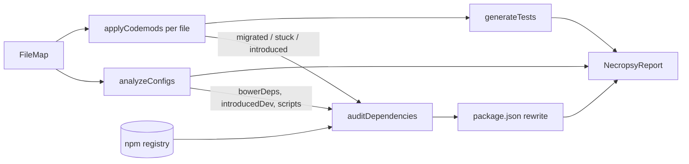

# Design — Audit engine

## Data flow

Codemods run **before** the dependency audit on purpose: whether `left-pad`
can be removed depends on whether every call site was rewritten.

## Interfaces

- `RegistryLookup = (name) => Promise<RegistryInfo>` — `npmRegistry()` (live,
  cached per run, 8 s timeout) or `snapshotRegistry()` (tests).
- `GRAVEYARD: Record<pkg, { status, cause, action, to?, codemods?, dev? }>` —
  curated knowledge. Live data never overrides a graveyard verdict, it only
  adds `latest` and the deprecation message.
- `majorsBehind(declared, latest)` treats `0.3 → 0.4` as a major step.

## Error handling

| Situation | Behaviour |
|---|---|
| registry 404 | `dead` (package unpublished) |
| registry timeout / 5xx | `unknown`, keep range |
| invalid package.json | throw; API returns 500 with message |
| GitHub 401 with token | retry anonymously |
| GitHub 403/429 | codeload zip fallback |

## Why a curated graveyard

npm's `deprecated` flag misses most real deaths: `request` is flagged, but
`mkdirp`, `rimraf`, `left-pad`, `grunt-contrib-qunit` (PhantomJS) and `bower`
are "alive" on the registry while being dead weight on modern Node. The
graveyard encodes the community knowledge; the registry keeps versions fresh.
