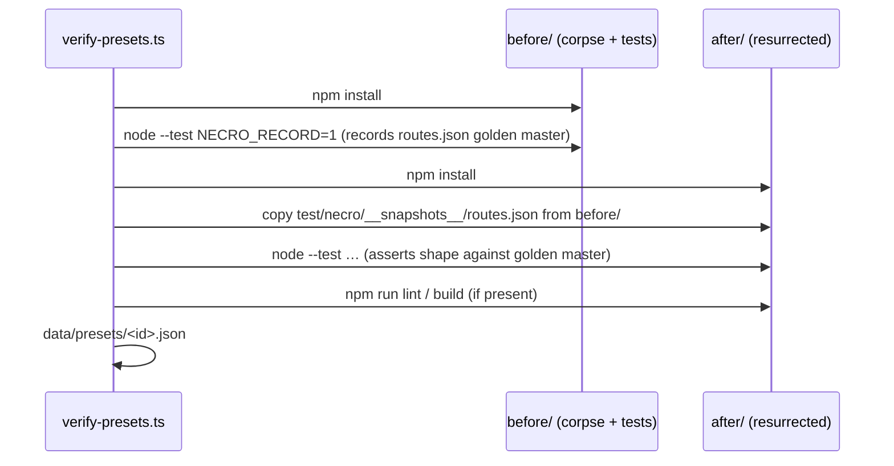

# Design — Test generation

## Why characterization tests

Legacy repos rarely have tests, and when they do they are bound to dead
runners (mocha 1.x, PhantomJS QUnit). We need tests that:

- exist even when the author wrote none,
- run on both trees without modification,
- encode *observed* behaviour, so a codemod that changes semantics turns red.

Sources of truth, from strongest to weakest:

| Strategy | Signal | Catches |
|---|---|---|
| `jsdoc-example` | author-documented input → output | semantic drift (e.g. left-pad's `0` padding) |
| `route-smoke` | every HTTP route answers without a 500 | removed Express APIs (`req.param`, `res.send(status, …)`) |
| `route-snapshot` | parameterless GET shape matches golden master | status, content-type, and JSON structure regressions |
| `module-load` | module evaluates | `GLOBAL`, `process.EventEmitter`, missing deps |
| `entrypoint-boot` | process stays alive / CLI doesn't stack-trace | `util.puts`, `os.tmpDir()` at startup |

## Evidence pipeline

The JSON reporter skips suite events and records `{name, ok, durationMs, error}`.
